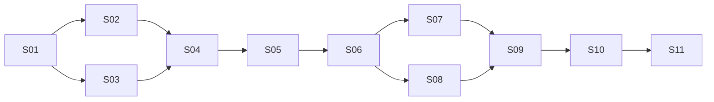

# План реализации агента подготовки процесса к цифровому мониторингу

Дата: 26 октября 2026 года. Версия: 0.4. План подготовлен Codex и Claude, после независимой рецензии. По просьбе пользователя приоритет изменён: сначала переносимый pilot MVP с HTML для раннего фидбека на корпоративной репе. Полные S02–S11 не объявляются завершёнными из-за наличия этого среза.

## Контрольная точка: переносимый пилот

27 октября: C1–C3 приняты по `code-first-completion.md`; 286 offline-проверок в workspace и на чистой установленной копии. Поставка R02 накоплена поверх чистой 0.1.0; подробности — `code-first-acceptance.md`. Более широкий S01–S11 остаётся ограничен доступными входами.

R01 принят на искусственных входах: 271 проверка в workspace и 271 на установленном кандидате патча; отдельное ревью Claude завершено. Основания — `graph-review-patch-acceptance.md`. Последующие C1–C3 согласованы в `code-first-completion.md`; полный S01–S11 не объявляется закрытым из-за готовности текущего пилота.

27 октября: C1–C3 приняты Codex — экспорт черновика материалов (часть S09 без официального шаблона), матрица E01–E21 `docs/ACCEPTANCE-MATRIX.md` (применимая к исходникам часть S10) и инструкции. Тесты исполнителем не запускались; независимые результаты Codex приведены выше. Сценарии матрицы, требующие записей, истории или справочников, остаются за пределами текущей приёмки и не удалены.

Новый срез R01 по запросу пользователя: анализ всей разрешённой области отдельными GLM-заданиями вместо одного запроса; контроль диапазонов, сохранение и возобновление заданий, ограниченные дополнительные чтения и иерархическая техническая сборка перед DeepSeek. Зависимости: текущий 0.1.0 → снимок без глобального char cap → задания/валидация/checkpoints → reducer → CLI/трейсы → патч и проверка на чистой распаковке 0.1.0. Файлы: source_tools.py, code_review.py, review_reduction.py, workflow.py, cli.py, tracing.py, новые проверки и инструкция патча. Инварианты: все разрешённые файлы учтены; лимит контекста действует на запрос; подтверждённые цитаты из замороженного снимка; технические связи не становятся бизнес-переходами; неуспешные задания/сборка видимы; сертификаты и описание П3283 не изменяются. Выход: offline-проверки, продолжение незавершённого запуска, dry-run/apply и полный тестовый прогон патча на архиве SHA-256 deb153d1c80b5d390094005912210af13336701647e77440b0d37810f7e388cc. Это срез S02/S03/S09, не завершение полного плана. R01 принят; см. отдельную приёмку R01.

Дополнение пилота П3283: пользователь разрешил включить полный последний ответ `П3283 DR 2.md` в частный архив и будет запускать его на собственной репе. Добавить явный preset `--process p3283`, загрузку полного UTF-8 текста с проверкой SHA-256, происхождение `derived_upstream/proposal`, `process-info` без сети, метаданные чтения в trace/diagnostics и отдельную инструкцию OpenCode. Реальный контекст остаётся вне Git и включается в ZIP только по точному allowlist. Проверка: в распакованном архиве бизнес-запрос содержит весь подготовленный текст и его hash совпадает с manifest; API подменён, реальная репа/модель не запускается. Пропажа/повреждение preset не даёт тихого запуска без описания.

Уточнение маршрутизации моделей: пользователь задал GLM-5.3 для анализа кода и DeepSeek-V4-Flash для бизнес-смысла. Добавить первый технический проход GLM; затем передавать бизнес-модели проверенные диапазоны, технические описания и inventory вместо полного кода. Карта/сценарии, смысл фактов, рекомендации и определения метрик — DeepSeek. Один оркестратор, четыре смысловых вызова, без автоматического fallback между ролями. Проверить разные URL/model, отсутствие исходного текста в бизнес-запросах, ошибки каждой роли и диагностику/трейсы. Корпоративная доступность остаётся внешней проверкой пользователя.

Дополнение по запросу пользователя: основной HTML должен показывать сценарии с операциями, развилками, исходами и возвратами внутри явно ограниченных областей этапов. Порядок операций и условия задаёт смысловой ответ с основаниями; список logger-вызовов не превращается в последовательность. Требуемые операции без кода и неподтверждённые ветви сохраняются. В режиме исходников убрать столбцы возможностей выполнения и доставки из основной таблицы, сохранив отдельные измерения в контракте для будущего анализа данных. Файлы: contracts.py, workflow.py, scenario_graph.py, compact_report.py, report.py, demo replay и проверки. Зависимости: строгие контракты и снимок → явные операции/сценарии → проверка ссылок → группировка/стрелки/карточки. Критерии: последовательность не выводится из порядка событий; отклоняются висячие ссылки; переходы и обязательные операции не исчезают; граф и карточки проверены в браузере, desktop/mobile; сбой стадии сохраняет неполный отчёт. Это уточняет срез S04/S10, не завершает полный план.

S01 завершён: контракты, manifest, пакет и независимый искусственный эталон проверены; замечания рецензии Claude исправлены Codex. Из последующих шагов реализован узкий вертикальный срез: безопасный ограниченный снимок текстов, проверка цитат, технический запрос GLM и три бизнес-запроса DeepSeek через общий API-адаптер, детерминированная оценка кандидатных фактов, рекомендации, определения метрик, JSON/Markdown/HTML и явный `incomplete` при сбое. Это даёт первый результат для оценки человеком, сохраняя неизвестные.

| Область плана | В пилотном срезе | Что остаётся |
|---|---|---|
| S02 | Чтение файлов, хеши, фиксированные цитаты, фильтрация, кандидаты эмиссии | AST/эвристика, многострочные вызовы, поля и обёртки реализованы; полный импорт/call graph и Git/deploy не реализованы |
| S03–S04 | Один оркестратор, строгий протокол, fake replay, сквозные четыре результата, GLM adapter | Дополнительные чтения по запросу модели и разбор доверенных решений в CLI не подключены |
| S05 | Ограниченный JSONL-профиль и явное соответствие верхнеуровневых полей | CSV, проверенные joins, полная семантика идентичности/окон/поставки |
| S06–S07 | Привязка кандидата факта к конкретным event keys, отдельные измерения покрытия, карточки с местами/проверкой | Принятый реестр требований, независимые возможности выполнения и проверка каналов реального пилота |
| S08 | Определения и все блокеры метрик, значение `null` | Исполнимые подтверждённые методики, числа, анализ задержек и обоснованные инсайты |
| S09–S10 | Файлы прогонов, offline HTML и CLI, упаковщик allowlist | Полный пакет официальной постановки, кеш live-ответов, проверки всех сценариев исходного плана |
| S11 | Инструкция запуска на корпоративном компьютере | Реальное приложение и доступ к модели в корпоративной сети ещё не проверены; готовые логи для первого прогона не нужны |

В архиве 0.1.0 технического индекса функций и дополнительных чтений нет. В текущем workspace R01 уже сохранены и offline-проверены `code_graph.py`, планировщик `code_review.py` и `review_reduction.py`; исполнители, дополнительные чтения и подключение к пользовательскому запуску реализуются Claude. Последние уточнения — `plans/graph-review-patch-updated-scope.md`; не считать библиотечные компоненты готовой поставкой.

Зависимости пилота: контракты → снимок и адаптер → workflow → CLI/HTML → тесты архива. Конфликтующие состояния не скрывать. Выход пилота: демонстрация и транспортный мок дают четыре результата, отказ модели сохраняет неполный отчёт, архив распаковывается и запускается без установки зависимостей. Результаты фактических проверок — в `docs/STATUS.md`. Список ниже сохраняет полный целевой план, а не обещает уже реализованные функции.


## 1. Результат и границы первой версии

Сделать локальный Python-пакет и CLI: пользователь передаёт бизнес-контекст, снимок приложения и, при наличии, логи; агент готовит четыре связанных результата:

1. Карту процесса с бизнес-операциями, переходами и разметкой технических событий.
2. Оценку достаточности необходимых наблюдаемых фактов и качества данных.
3. Адресные предложения по разметке, обогащению, логированию или поставке данных.
4. Каталог метрик с формулами, зависимостями, блокерами и допустимыми расчётами.

Общий manifest и реестр evidence связывают результаты. Читаемый Markdown-отчёт представляет те же данные, не пересчитывая статусы в шаблоне.

Первый демонстрационный проход — один искусственный процесс на Python и JSONL. CSV добавляется как второй файловый формат на том же контракте. Бизнес-контекст можно передать обычным текстом. Ответ другого исследовательского агента — дополнительный необязательный материал, а не условие запуска.

Не входят в MVP: новое веб-приложение, БД, графовая платформа, обучение моделей, предсказание следующего события, Kafka-инфраструктура, автоматическая установка логирования и отправка пакета в корпоративные системы. Встроенная команда не должна исполнять анализируемый код, произвольные SQL/Python-формулы или команды из документов.

Главный компромисс: сначала получить узкий сквозной результат, сохранив в контракте неизвестные и ограничения, затем расширить проверку идентичности, времён и качества. Полнота схемы всех каналов заранее не требуется.

## 2. Что подготовлено

- Workspace, локальный Git без remote и коммитов, инструкции и каталог исходных материалов.
- Контекст в `docs/PROJECT-CONTEXT.md`; происхождение и хеши в `materials/source-register.json`.
- Неизменённые кандидаты переноса в `references/pko/`; они ещё не являются кодом нового пакета.
- Промпт для пробного бизнес-описания в `prompts/upstream-process-description.md`.
- Проверены локальные кандидаты PKO; результаты прошлой проверки не являются тестами этого проекта.

Нет реального приложения, его логов, подтверждения доступности выбранного GLM endpoint из PKO, полного шаблона постановки на учёт и всех формальных методик. Это не блокирует S01–S10; реальная валидация вынесена в S11.

## 3. Минимальная архитектура

```text
CLI / run configuration
  ├─ inputs + rules + source snapshot + optional telemetry
  ├─ source index / list / read / search / emission candidates
  ├─ semantic model boundary (offline fake or configured live adapter)
  └─ one orchestrator
       1 map → 2 coverage → 3 recommendations → 4 metrics
          └─ evidence registry + run manifest → report / onboarding draft
```

LLM формулирует бизнес-смысл, сопоставления и предложения. Код проверяет ссылки, идентичность и структуру, профилирует данные, вычисляет покрытия и разрешённые метрики. Нет обязанности делать отдельного агента на каждую стадию.

Пакет `src/process_observability/`:

| Модуль | Ответственность |
|---|---|
| `contracts.py` | Типы, закрытые словари состояний, сериализация и проверки связей |
| `inputs.py`, `rules.py` | Бизнес-текст, производные описания, происхождение и применимость правил |
| `snapshot.py`, `source_tools.py`, `redaction.py` | Замороженные исходники, безопасное чтение, литеральный поиск, лимиты и безопасная выдача |
| `evidence.py`, `static_scan.py` | Диапазоны/цитаты и места возможной эмиссии |
| `llm.py`, `prompts/` | Один протокол смысловых задач и адаптер выбранного API |
| `process_map.py` | Карта и роли событий в выполнении операций |
| `telemetry.py`, `identity.py` | JSONL/CSV, профиль, соединения, попытки и дубли |
| `coverage.py`, `instrumentation.py` | Необходимые факты и адресные рекомендации |
| `metrics.py`, `insights.py` | Определения, разрешённые расчёты и ограниченные объяснения |
| `workflow.py`, `manifest.py`, `report.py`, `cli.py` | Последовательность, зависимости, сохранение и представление |

Это границы ответственности; небольшие смежные функции допустимо держать вместе до появления реальной сложности. Контракты начать с dataclass/enum и явных валидаторов, без собственного универсального языка правил.

### Переиспользование PKO

- Перенести логику проверки диапазонов из `review_evidence.py`, сохранив происхождение и значимые проверки. Сверять с локальным сырым текстом, но во внешнюю выдачу/общий evidence сохранять безопасную цитату, хеш исходного диапазона и локатор; исходник остаётся в разрешённом локальном снимке. Не переносить выдачу сырого фрагмента в ошибке. Выходные флаги проверки выставляет новый код; присланные моделью флаги игнорируются. Непринятый пакет evidence не должен оставлять подтверждённые части как итог всей проверки.
- Адаптировать `ToolBox.list_files/read_file/search`, минимальный `FileTree` и фильтры. Удалить зависимости от `pko.*`, `Extraction`, taxonomy и шкалы готовности. Фильтрацию секретов применять к каждому каналу выдачи, включая готовые факты.
- Взять идеи объявлений и вызовов из Python-экстрактора. Места `logger.info`, wrappers, publish и смен состояния извлекать отдельно: текущий `_own_calls_only` удаляет внешние вызовы. Совпадение коротких имён не доказывает связь.
- Адаптировать подход сценариев до анализа реализации и проверку всех привязок. Не переносить объектную модель BBB, старые стандарты/веса, matcher/critic/coherence, GO/PIVOT, web/DB и общий runner.
- Проверки пути написать/проверить заново под контракт замороженного каталога: абсолютный путь нельзя сначала обрезать и считать относительным; проверить `..`, symlink и выход за корень. Имя безопасного helper не является доказательством безопасности.
- `_mask_secrets`, `_is_blocked`, regex-эвристику и произвольный `GitRepo.run` не принимать без переработки. В MVP модель задаёт литеральную строку поиска, не произвольный regex. Git-методы имеют фиксированные аргументы, проверенные refs и отключённые external diff/textconv/fsmonitor; модели не доступен универсальный git-вызов. `.git/` не входит в локальный source snapshot.

## 4. Контракты результатов

Все артефакты содержат `schema_version`, `run_id`, `input_fingerprints`, `status` и ссылки на evidence. Неизвестное — явное состояние, а не пустая строка, ноль или ложный успех.

**Общие основания.** `SourceSnapshot` фиксирует роль источника, Git revision либо хеш содержимого, конфигурацию и способ получения. `EvidenceRef` различает код, запись данных, документ и ответ внешнего агента; хранит доступный локатор, цитату/фрагмент, отпечаток и отдельные результаты проверки текста и смысловой привязки. Для кода нужны относительный путь, символ, строки и revision/hash; для логов — файл/партиция, строка/ключ и правила извлечения.

Цитата, найденная в ответе внешнего агента, подтверждает только наличие текста в его ответе. Первичный документ подтверждён только после отдельной проверки доступного фрагмента. Static code evidence никогда не устанавливает состояние `observed` само по себе. При маскировке текста проверяется хеш сырого диапазона локально; маскированная цитата не выдаётся за буквальную копию первоисточника.

**Правила.** `RuleRef` содержит происхождение, локатор, authority, applicability, выбранное решение и результат проверки данных. Предложение DOCX остаётся proposal; локальная инструкция — snapshot; принятый контракт указывается только при наличии основания его принятия. Неприменимость и отсутствие данных различаются. `decisions.json` — необязательный доверенный вход из конфигурации проекта: ID решения, автор/роль, дата, область и основание. Модель и внешние документы не могут создавать accepted-решения. Состояния `verified`, `accepted`, `observed`, `not_applicable_approved` и authority выставляет только соответствующий валидатор/загрузчик доверенного входа, а не ответ модели.

**1. `process_map.json`.** Границы/цель, определение случая, этапы, условия переходов, альтернативы, исполнители/системы, результаты и неизвестные. Связаны три представления: требуемое, найденная реализация, наблюдаемое. Для каждого — свои основания. Ветвь с одним известным исходом сохраняется как неполно описанная, а не дополняется выдуманным исходом.

Внутри карты — event mapping: технический признак → бизнес-действие → операция → этап; роль записи (например, запрос, начало, результат, ошибка, UI-информация), правило спаривания/группировки в отдельное выполнение и статус предложения. Несколько записей не считаются несколькими выполнениями автоматически.

**2. `log_coverage.json`.** Список `RequiredFact`: смысл, область/условие применимости, основание необходимости, зависимые аналитические вопросы/метрики и допустимые способы подтверждения. Для каждого факта отдельно:

- статическое инструментирование и смысл записи;
- сведения о возможностях/фактическом выполнении: `known_zero`, известное число или `unknown`;
- ожидаемая/фактическая поставка и полнота окна;
- качество, связь с бизнес-случаем и пригодность для конкретного расчёта.

Нельзя свести это в один нечёткий процент. Сводки показывают числитель, явный знаменатель применимых требований, неизвестное и исключения. Неизвестные применимые требования остаются в знаменателе; неподтверждённые кандидаты показываются отдельно. Утверждение только из proposal/upstream без другого основания остаётся кандидатом/условной рекомендацией и не увеличивает знаменатель принятых обязательств. Если сам состав обязательств пока не установлен, сводка помечается `scope_provisional`: покрытие найденных фактов не объявляется полным покрытием процесса.

`known_zero` требует независимого от отсутствия проверяемого события основания о возможностях выполнения и полноты соответствующей области/окна: входные условия, история переходов либо контролируемый прогон. Ноль событий в «полном файле» этого не доказывает. Снимок текущего состояния не равен истории совершённых переходов. Редкая ветка и известная потеря события не получают одинаковый статус.

**3. `instrumentation_plan.json`.** Карточки: закрываемый факт, действие `map_existing/join/enrich/add_field/add_event/move_emit/fix_delivery`, основание, место/версия кода либо `location_unresolved`, семантика, поля с условиями, момент относительно транзакции/асинхронного перехода, зависимости, включаемые метрики и проверка результата. Новое событие не является предпочтением по умолчанию. Достаточный existing join также не следует требовать повторно написать в raw-log.

**4. `metric_catalog.json`.** Назначение, исполнимая или пока текстовая формула, единица счёта, когорта/окно, границы времени, незавершённые случаи, поздние данные, зависимости и `readiness {primary, blockers[]}`. Отсутствующий расчёт — `value: null` с причиной. Формулы исполняются только зарегистрированными детерминированными функциями; модель не поставляет исполняемый SQL/Python.

`manifest.json` связывает входы/версии/режимы и завершённость стадий; `evidence.jsonl` содержит основания; `report.md` представляет четыре результата. Дополнительные структурированные инсайты допустимы в составе каталога/отчёта, без отдельного обязательного продукта.

## 5. Входы, LLM и сохранение

- Код: локальный каталог или Git revision, разрешённые файлы, лимиты и воспроизводимый снимок. Секреты исключаются до передачи модели; анализируемый Python не импортируется.
- Бизнес-контекст: обычный Markdown/текст. У upstream-агента запрашивается понятное описание и основания без предписания таблиц, SQL, поисковых инструментов и обязательного JSON. Внутренний импортёр позже приведёт ответ к нашему контракту; он не повышает статус утверждений до accepted/observed.
- Для MVP upstream-ответ достаточно загрузить как ещё один текстовый источник с ролью `derived_upstream`; отдельный структурный импортёр/connector не нужен. Если первичные материалы недоступны, их цитаты остаются непроверенными.
- `reference_data`: необязательные локальные таблицы/JSONL с историей состояний, контролируемыми входами или соответствиями message/job→case. Для них фиксируются источник, ключи, as-of/окно, полнота и authority. Они не приравниваются к истории только по имени файла и проверяются по своей семантике.
- Логи: JSONL/CSV плюс явное соответствие исходных полей. Сохранять оригинальные имена/значения; канонизация имен и единиц выполняется видимым адаптером. Не требовать 21 или 35 атрибутов в каждой записи.
- Лимиты: по умолчанию превышение размера/числа записей — явная ошибка. Если пользователь выбирает ограниченный анализ, сохранить границы, `partial_input` и последствия для каждой метрики. Молчаливой выборки нет.
- Модель: `SemanticModel` с offline fake и транспортом/моком одного предполагаемого API. Fake привязан к `task + prompt_sha + payload_sha`, промах даёт ошибку. Конкретный live-провайдер и его API/SDK проверяются после выбора endpoint на отдельной контрольной точке S03-L, до реального пилота; это не блокирует offline-выход S03. Не строить универсальный клиент и не связывать продукт с CLI Claude.
- Смысловые задачи получают подготовленный оркестратором контекст. Для MVP достаточно одного структурированного раунда запроса дополнительных чтений с ограничением объёма; универсальный tool-calling loop отложить до доказанной потребности. Задать бюджеты контекста/времени и явный `incomplete` при исчерпании.
- Live-payload строится из разрешённых типизированных полей, а не из сырого run-объекта или всех значений логов. Один контур безопасной выдачи покрывает source tools, feedback повторной попытки, evidence, отчёт, manifest, записи fake/LLM cache и исключения. Проверить JSON с ключами в кавычках, строковые значения с пробелами, PEM внутри кода, URL с credentials, Authorization и credential-файлы; известные regex-помощники PKO не гарантируют их защиту.
- Нет endpoint/авторизованного режима передачи — live-режим сообщает это явно. Fake включается только явно в тесте/демо; тихого fallback нет. `data_origin` и `model_mode` независимы и видимы в отчёте.
- Детерминированные стадии в MVP пересчитывать. В S09 достаточно обнаружения устаревших anchors и локального кеша ответов модели по точному fingerprint задачи/входов/версий; переиспользование готовых стадий по сложному графу зависимостей отложить. Артефакты сохраняются раздельными прогонами.

## 6. Последовательность реализации

Каждый шаг — небольшой проверяемый набор изменений. Перед началом прочитать этот раздел, контекст и статус; после шага обновить статус с командами/результатами. Не помечать будущие команды как выполненные.

### S01 — Каркас, контракты и искусственный эталон

**Зависимости:** нет. **Контекст:** сейчас есть документы и reference-код; рабочего пакета нет. Цель — зафиксировать смысл четырёх выходов до реализации оценок.

**Файлы/задачи:** `pyproject.toml`, `__init__.py`, `__main__.py`, `contracts.py`, `manifest.py`, пример `decisions.json`, `tests/test_contracts.py`; исходный fixture-пакет с бизнес-описанием, маленьким Python-приложением и таблицей сценариев. Из таблицы сценариев формировать JSONL и независимо проверенный `ground_truth.json`, который конвейер не читает; приложение ради логов не запускать. Oracle опирается на символы/ключи событий, не на фиксированные номера строк. Отделить script-модель от oracle. Не копировать приватные тексты в фикстуры.

**Проверить:** round-trip JSON, обязательные причины блокировки, отклонение всех model-supplied доверенных статусов/authority, разные source kinds, независимость synthetic/real от fake/live, неизвестная формула не исполняется. Команда после реализации: `PYTHONPATH=src python3 -B -m unittest discover -s tests -p 'test_contracts.py'`.

**Выход:** пакет импортируется через PYTHONPATH, контрактные проверки выполняются offline с ненулевым числом тестов; fixture явно искусственный. Версия Python записана в README. Установка через pip — отдельная проверка при доступном build backend, не скрытая сетевая предпосылка S01. **Откат:** удалить только введённый каркас либо отменить отдельный локальный коммит; пользовательские материалы не затрагивать.

### S02 — Чтение исходников, evidence и места эмиссии

**Зависимости:** S01. **Контекст:** минимальный перенос PKO, без импортов его приложения. Этот шаг не строит бизнес-карту по одним именам функций.

**Файлы/задачи:** `snapshot.py`, `source_tools.py`, `evidence.py`, `static_scan.py`, `redaction.py`; `tests/test_source_tools.py`, `test_evidence.py`, `test_static_scan.py`, `test_redaction.py`. Перенести чтение/литеральный поиск, проверки цитат, минимальные объявления/вызовы; добавить emission-кандидаты. Для локального снимка читать фактически зафиксированные байты, обнаруживать изменение входов во время снимка; версия deploy/config, если неизвестна, не устанавливается по совпадению имени.

**Проверить:** `logger.info` не исчезает; путь/диапазон существует; чужой `verified` игнорируется; ошибка проверки отклоняет пакет атомарно; `.env`, credential-файлы, абсолютные пути, `..`, symlink наружу и canary-секреты во всех выдачах; изменившийся снимок инвалидирует якорь. Git-интерфейс не принимает произвольные флаги/ref-опции, не допускает `--output`, external diff/textconv/fsmonitor и исполнения конфигурации как внешней программы. Только фиксированные операции rev-parse/ls-tree/cat-file; при нужном diff — фиксированные безопасные опции. Наличие git проверяется в тестовой фикстуре; отсутствие даёт явный skip только Git-тестов.

**Команда:** `PYTHONPATH=src python3 -B -m unittest discover -s tests -p 'test_source*.py'` и соответствующие `test_evidence.py`, `test_static_scan.py`.

**Выход:** независимое ядро не импортирует `pko` и не исполняет приложение; все прямые переносы имеют provenance. **Откат:** отменить перенос, сохранив контракты S01.

### S03 — Смысловая карта и граница модели

**Зависимости:** S01; интеграция с S02 в S04. **Контекст:** S01 фиксирует протокол чтения/DTO; S03 использует дерево в памяти и fake-валидацию. Его source-anchors до S04 остаются непроверенными, а не требуют готового S02. На входе бизнес-текст и ограниченные source facts, не весь репозиторий.

**Файлы/задачи:** `llm.py`, `inputs.py`, `rules.py`, `process_map.py`, `src/process_observability/prompts/map.md`, `tests/test_process_map.py`, `test_model_boundary.py`, `test_upstream_input.py`. Реализовать fingerprint-bound fake, транспортный мок и один дополнительный раунд чтений; карту с сохранением ожидаемых этапов и словарь ролей событий. Импорт текста другого агента — обычный прозаический источник derived_upstream без нового parser-framework. Решения загружаются из отдельного доверенного входа.

**Проверить:** обязательный отсутствующий этап сохраняется; источник To Be не становится As Is; цитата без первичного текста остаётся external/unverified; предложение не создаёт принятое обязательство; бизнес-ID не приравнивается к trace; неполная развилка остаётся неполной; неподдержанный ответ/бюджет даёт incomplete. Модель/HTTP мокируются; отсутствующая запись fake — ошибка. S03-L после выбора provider/data policy реализует и отдельно проверяет один live-адаптер; сетевые вызовы/передача реальных данных не являются условием offline-приёмки S03.

**Команды:** `PYTHONPATH=src python3 -B -m unittest discover -s tests -p 'test_process_map.py'`, затем `test_model_boundary.py`, `test_upstream_input.py`.

**Выход:** первый выход на мини-входе с evidence и неизвестными, без фиктивной runtime-наблюдаемости. **Откат:** выключить live-адаптер, сохранить входной контракт; не подменять результат fake без указания режима.

### S04 — Первый проход через все четыре стадии

**Зависимости:** S02, S03. **Контекст:** один обычный путь искусственного процесса, явные ID, определённая метрика полного времени и одна недоступная метрика работы. Цель — полезный проход до сложного обобщения.

**Файлы/задачи:** `workflow.py`, `cli.py`, базовые `telemetry.py`, `coverage.py`, `instrumentation.py`, `metrics.py`, `report.py`; `examples/synthetic/project.json`, `tests/test_vertical_slice.py`. Реальный детерминированный код читает fixture, проверяет proposals модели, сопоставляет события, фиксирует один пробел с реальным якорем и вычисляет разрешённую метрику. Не возвращать целиком заранее написанные четыре результата.

**Будущий запуск:** `PYTHONPATH=src python3 -B -m process_observability run --config examples/synthetic/project.json --model-mode fake --out runs/synthetic`.

**Проверить:** четыре JSON + evidence + manifest + отчёт; данные/модель помечены synthetic/fake; сеть в offline-прогоне запрещена; предложенное событие не даёт числовую метрику; повторный запуск в новый каталог не перетирает исходники. Число и состав проверок выводятся явно.

Содержательная приёмка: значение метрики совпадает с независимым расчётом oracle; указан конкретный ожидаемый пробел и проверенный S02 якорь. Удаление записи/эмиссии в копии fixture меняет результат или явно инвалидирует fake/evidence. `ground_truth.json` запрещён как вход конвейера. Новое запланированное событие не меняет рассчитанное число.

**Выход:** воспроизводимый вертикальный пример с одним расчётом и одним содержательным блокером. Это демонстрация конвейера, не доказательство качества live-LLM. **Откат:** отменить интеграцию; результаты в runs сохраняются как история или удаляются отдельно по решению пользователя.

### S05 — Идентичность, время и профиль данных

**Зависимости:** S04. **Контекст:** нельзя принять повтор доставки за повтор процесса и нельзя отделить работу от ожидания по неподходящим границам.

**Файлы/задачи:** `identity.py`, расширение `telemetry.py`; `tests/test_identity.py`, `test_telemetry.py`, `fixtures/identity/`, `fixtures/time/`. JSONL/CSV, raw→canonical mapping, потоковое чтение в пределах лимитов, парсинг/ошибки/условная заполненность, время события и загрузки, окно, идентификаторы случая/выполнения/попытки/доставки, join-правила и необязательные reference_data с полнотой/as-of.

**Проверить:** job→case может быть many-to-one, если каждый job однозначно относится к случаю в нужной области; 1:1 не универсальное требование. Стабильный occurrence ID не меняется при redelivery, законный повтор получает новое выполнение. Неизвестную идентичность не угадывать. Completion-only данные могут подтверждать результат, но не всегда длительность. CSV-строка с числом допустима при явном парсинге; дату 1970 проверять относительно заданной области, а не объявлять всегда невалидной. Отрицательное время и смещение часов не исправляются молча.

**Команды:** `PYTHONPATH=src python3 -B -m unittest discover -s tests -p 'test_identity.py'` и `test_telemetry.py`.

**Выход:** профиль объясняет ограничения по каждому расчёту; лимиты и частичный набор видимы; нет универсального требования нового event_id/raw case ID при достаточном существующем основании. **Откат:** отключить новые правила соединений/группировки, затронутые результаты вернуть в unknown, пересчитать зависимости.

### S06 — Необходимые факты и доказуемое покрытие

**Зависимости:** S03, S05. **Контекст:** набор необходимых фактов выводится из вопросов бизнеса, карты и зависимостей метрик; пользователь не заполняет заранее каталог всех событий.

**Файлы/задачи:** `coverage.py`, уточнение контрактов при необходимости одним владельцем, `tests/test_coverage.py`, `fixtures/coverage/`. Зафиксировать применимые требования до расчёта сводки; поддержать альтернативные способы доказательства факта и разные уровни подтверждения.

**Проверить:** отсутствующая реализация отличается от дырки логирования; редкая ветка с unknown opportunities отличается от независимого доказанного нуля и от выполненной ветки без события; статическое место не закрывает доставку; явное исключение не равно пропуску; unknown остаётся видимым в знаменателе. Только proposal/upstream не создают required без аналитического/принятого основания; при неустановленном составе есть scope_provisional. Заполненность считается на применимом подмножестве; неизвестное условие даёт unknown, пустой неприменимый атрибут не дефект. Блокер зависит от факта/когорты, а не автоматически запрещает любую метрику процесса.

**Команда:** `PYTHONPATH=src python3 -B -m unittest discover -s tests -p 'test_coverage.py'`.

**Выход:** каждый статус и сводка объяснимы конкретными основаниями/правилами; нет единого «процента готовности» с выдуманными весами. **Откат:** вернуть версию правил покрытия и инвалидировать зависимые рекомендации/метрики.

### S07 — Адресный план инструментирования

**Зависимости:** S02, S06. **Контекст:** предпочтителен минимальный способ закрыть пробел, а не добавление логов в каждую функцию.

**Файлы/задачи:** `instrumentation.py`, `src/process_observability/prompts/instrumentation.md`, `tests/test_instrumentation.py`, `fixtures/instrumentation/`. Карточки вида/семантики/места изменения, зависимостей и теста. Проверять ссылку на текущий source snapshot. Сохранять исходный контракт канала и отдельно предложенную нормализацию.

**Проверить:** пригодное существующее событие маппится, отсутствующее поле обогащается или добавляется; неизвестное место не получает выдуманную строку. Pre-commit request допустим, pre-commit success не подтверждает committed outcome; after-commit log не объявляется гарантированно доставленным. Существующий outbox — вариант для критичного факта, не обязательная новая инфраструктура.

**Команда:** `PYTHONPATH=src python3 -B -m unittest discover -s tests -p 'test_instrumentation.py'`.

**Выход:** разработчик может понять, где и зачем менять приложение и чем проверить результат. Артефакт — предложение; приложение не меняется. **Откат:** аннулировать версию карточек и их связи, не менять источник.

### S08 — Метрики и информативные выводы

**Зависимости:** S06; IDs рекомендаций связываются при S09. **Контекст:** метрика определяется вопросом, когортой и входными фактами. Формальные названия не заменяют методики.

**Файлы/задачи:** `metrics.py`, `insights.py`, реестр небольшого числа calculators, `tests/test_metrics.py`, `test_insights.py`, `fixtures/metrics/`. Начать с явно определённых диагностических длительностей/долей/повторов. Пять формальных направлений держать отдельными спецификациями: если методики/внешних источников нет, сохранять соответствующие блокеры.

**Проверить:** числитель/знаменатель и case/occurrence/attempt не смешиваются; ноль, неизвестное, отсутствие случаев и неприменимость различаются; открытые/поздние случаи следуют объявленной политике. Если политика/окно/когорта не заданы, допускается явный `tool_default` с происхождением либо блокер `policy_undeclared`, но не тихое умолчание. Не выдавать wait/work без границ; один metric может иметь несколько блокеров. Расчёт не выполняет строку формулы как код. Повтор UI-записи не равен петле, законная доработка не объявляется дефектом без правила.

**Инсайт:** показывать вопрос, наблюдение, затронутые случаи/операции, основу сравнения, возможный механизм, ограничения и масштаб вывода. Подтверждённый механизм одного случая не распространять автоматически на весь процесс; частый error_code не объявлять корневой причиной. Для первой версии достаточно детерминированных срезов и ограниченного смыслового пояснения, без причинного ML.

Числа и количественные сравнения в пояснении заполняет код из рассчитанных артефактов. Модель не добавляет свои значения или числовые утверждения; проверить попытку такого добавления и отсутствие влияния на итоговую выдачу.

**Команды:** `PYTHONPATH=src python3 -B -m unittest discover -s tests -p 'test_metrics.py'` и `test_insights.py`.

**Выход:** любой числовой результат воспроизводим из зафиксированных входов; недоступные метрики объяснены, а не скрыты. **Откат:** отключить новые calculators/insight rules, сохранить определения с явной недоступностью расчёта.

### S09 — Сохранение результатов и черновик пакета постановки

**Зависимости:** S07, S08. **Контекст:** удобно продолжать анализ без потери уже подтверждённого и передавать результат аналитику/разработчику; официальный шаблон пока неизвестен.

**Файлы/задачи:** `manifest.py`, `workflow.py`, `report.py`, экспорт словаря CSV, `tests/test_resume.py`, `test_report.py`. Связать рекомендацию с включаемыми метриками, сохранить основания, открытые решения и незавершённость стадий. Добавить проверку устаревших anchors и точный кеш ответов модели; детерминированные стадии пересчитывать. Не строить универсальный DAG/cache engine.

**Устаревание и повтор:** fingerprints различают код, бизнес-контекст, правила/решения, модель/промпт, reference_data и телеметрию. После изменения кода прежние якоря не принимаются. Логи не входят в payload независимого business-required view и не должны менять его состав; наблюдаемое представление пересчитывается. Все артефакты включают версию анализатора. При совпадении полного ключа допускается reuse только ответа модели; сохранённый статус проверки данных или якоря не переиспользуется вслепую.

**Пакет:** описание/границы, карта, словарь событий, case/join-решения, покрытие/качество, план логирования, спецификации метрик, источники и открытые вопросы. Это черновик для постановки, не заявление о формальном прохождении процесса или готовой интеграции с ARIS/PM/BI.

**Команды:** `PYTHONPATH=src python3 -B -m unittest discover -s tests -p 'test_resume.py'`, `test_report.py`; затем повтор CLI на изменённых fixture inputs и ручная проверка Markdown.

**Выход:** устаревшие якоря не принимаются, повторный расчёт использует текущие входы, частичный проход не выглядит завершённым. **Откат:** выключить кеш модели и пересчитать проход; отчёт остаётся представлением JSON.

### S10 — Приёмка на независимых искусственных сценариях

**Зависимости:** S09. **Контекст:** зелёные unit-тесты и красивый fake-ответ не доказывают устойчивость полного конвейера.

**Файлы/задачи:** `tests/test_evaluation.py`, независимые fixtures/oracle для матрицы ниже, пользовательский пример и краткая инструкция. Прогнать источник/логи/модель с ошибками и неполнотой. Проверять содержательные утверждения и отсутствие недопустимых чисел, а не только точное совпадение всего JSON.

**Команды:** `PYTHONPATH=src python3 -B -m unittest discover -s tests -p 'test_*.py'`; итог должен содержать ненулевое число тестов, passed/failed/skipped. Дополнительно CLI на примере. Проверить границы файлов и отсутствие секретов/реальных данных в отслеживаемых файлах. При добавленных зависимостях перед коммитом выполнить соответствующий аудит и разобрать результаты.

**Выход:** все обязательные offline-сценарии пройдены либо конкретный неподдержанный вариант явно ограничен без ложного положительного результата; данные и fake-режим помечены. Записан список принятых ограничений MVP. **Откат:** откатить последний нарушающий инвариант шаг или отключить конкретную функцию, сохранить красный regression-case.

### S11 — Реальный пилот и решение о следующем расширении

**Зависимости:** S10 и реальные входы. **Контекст:** готовность к пилоту и успешный пилот — разные результаты; пользователь заранее не предоставлял нужные входы.

**Нужно получить:** один ограниченный процесс/цель, source/config snapshot, логовое окно и сведения об его полноте, case/join-основания, доступный канал/методики и разрешённый LLM-режим. Для проверки конкретной формальной метрики — её формулу и именно её внешние зависимости; отсутствие всех пяти источников не блокирует всякую полезную диагностику.

**Действия:** сравнить карту/разметку с владельцем/аналитиком, выборочно проверить исходные случаи и якоря, сопоставить расчёты с независимым эталоном. Если инструментирование меняется, собрать новое окно и повторить покрытие до повышения готовности метрик. Отдельно протестировать ответ upstream-агента по промпту; если он полезен, принять его как производный вход с проверяемыми основаниями. Автоматический connector строить только после проверки формата/доступа и необходимости.

**Измерить:** время аналитика/разработчика и календарную длительность подготовки, число итераций, найденные/пропущенные пробелы по определённому baseline. Не обещать заранее проценты экономии/точности.

**Выход:** отчёт о реальном пилоте с подтверждёнными результатами/ограничениями. До появления входов статус `awaiting_pilot_inputs`, S01–S10 остаются самостоятельной завершённой разработкой. **Откат:** прекратить пилотный прогон, сохранить проверенные артефакты и ограничения; никаких изменений сторонних систем без отдельного поручения.

## 7. Зависимости и параллельность



Допустимые линии разработки: S02 (`snapshot/source_tools/evidence/static_scan` и свои тесты) параллельно S03 (`llm/inputs/rules/process_map` и свои тесты); S07 (`instrumentation`) параллельно S08 (`metrics/insights`). Общие контракты и fixture-base меняются одним владельцем последовательно. Интеграционные `workflow/cli` принадлежат S04/S09. При необходимости изменения общей схемы сначала согласовать и завершить её изменение, затем продолжать линии. Это не параллельные агенты продукта.

## 8. Матрица обязательных проверок

| ID | Сценарий | Что должно сохраниться в результате |
|---|---|---|
| E01 | Обязательный этап/отказ отсутствует в коде | Видимый обязательный шаг и пробел реализации; не удалять из карты |
| E02 | Редкая instrumented-ветка не встретилась | Разделить unknown opportunities и доказанный ноль; отсутствие записи не равно отсутствию логирования |
| E03 | История состояний подтверждает переход, события нет | Видимая потеря/несоответствие телеметрии, не замаскирована наличием callsite |
| E04 | Несколько job ведут к одному case через проверенный mapping | Допустимая заданная кардинальность, coverage соединения и неоднозначности |
| E05 | Redelivery, retry и законный бизнес-возврат | Разные единицы: доставка, попытка, выполнение; не схлопывать законный повтор |
| E06 | Show/Click/metric принадлежат одному выполнению | Группировка по основанию, а не счёт строк и не unique_step как dedup ID |
| E07 | Request до commit и последующий rollback | Не считать committed success; учитывать реальные гарантии записи/поставки |
| E08 | Полноценный факт completion без start | Результат может подтверждаться, длительность/работа остаются недоступными по своим зависимостям |
| E09 | Смещение часов, поздняя партия, невалидная дата | Явная диагностика; не заменять длительности нулём и не терять ограничения окна |
| E10 | Receive/assignment имеются, work-start отсутствует | Не называть назначение началом человеческой работы |
| E11 | Формальная метрика без формулы и внешнего источника | `value=null`, одновременно все соответствующие блокеры |
| E12 | Proposal расходится с принятым контрактом | Сохранить происхождение и конфликт; не объявлять нарушение по proposal |
| E13 | Source v2 сдвинул/удалил место эмиссии | Старый якорь не принимается, зависимые результаты инвалидируются |
| E14 | Лимит размера/строк, частичный файл, ошибки парсинга | Явная остановка или заявленная частичная область; без молчаливой выборки |
| E15 | Upstream выдал To Be как этап и цитату без первоисточника | Не повышать до факта текущего исполнения; сохранить кандидат/непроверенное основание |
| E16 | Пустая когорта/открытые случаи/дубли | Не путать отсутствие случаев и неизвестное с нулевой частотой; объявленные denominator и политика |
| E17 | Инструкция в исходнике, symlink, credential-файл, секрет в JSON/PEM/URL/feedback | Данные не исполняются; canary не попадает в payload, evidence, report, manifest, fake/cache или исключения |
| E18 | Источник/LLM недоступен или бюджет исчерпан | Частичный результат и причина; fake/live не подменяются молча |
| E19 | Условный атрибут: применим, неприменим, условие неизвестно | Проверка на своём подмножестве; пустое неприменимое значение не дефект; proposal не создаёт нарушение |
| E20 | Изменён source/log fixture, прежние записи fake | Явный промах по fingerprint или изменённый результат; oracle независим и не читается конвейером |
| E21 | LLM добавляет число/количественное объяснение вне артефактов | Итоговые числа формирует только код, неподтверждённое утверждение не публикуется |

## 9. Продолжение работы и открытые решения

Следующий исполняемый шаг — S01. Для него не требуется выбирать реальный бизнес-процесс или endpoint. S02/S03 могут идти независимо после фиксации контрактов S01; S04 даёт первый результат, который можно проверить целиком.

Открытые решения фиксировать с влиянием и временным поведением: `pilot_process`, `target_stack`, `channel_contract`, `llm_provider/data_policy`, `case_definition`, `formal_methodologies`, `registration_template`, пригодность ответа внешнего агента. Они не должны превращаться в цепочку обязательных вопросов перед каждым техническим шагом.

Если меняется граница шага, обновить его входы, затронутые файлы, зависимости и проверку. Если сценарий недоступен, явно ограничить результат, а не удалить сценарий или назвать проверки пройденными. Отдельные commits/PR могут использоваться при реализации; remote, push, публикация и deployment сейчас не настроены и не выполняются.
